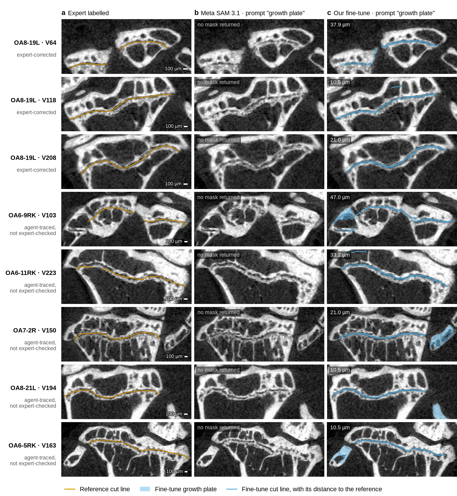

# Plate fine-tune: SAM 3.1 trained to find the growth plate in micro-CT knee sections

This directory trains and scores the model behind Voluma's growth-plate cut line, and holds its Modal inference app
(`serve.py`, deployed by hand). No Voluma app imports it and no run snapshots it. Every method we tried, including the ones
not carried here, is in [METHODS.md](METHODS.md).

## What the model does

In a coronal section of a mouse tibia (micro-CT, 10.5 µm voxels), the **cut line** runs through the centre of the growth plate
across the whole bone. It splits the epiphysis (the IIOC, above) from the metaphysis (below), and the downstream measurements
depend on it. We fine-tune Meta's SAM 3.1 image model with a text prompt, two ways:

- **Region (recipe A):** prompt "epiphysis", target the IIOC region above the cut line. The cut line is the region's lower edge.
- **Band:** prompt "growth plate", target the plate itself: per column from the traced proximal face to the distal face, plus
  the cut line dilated by 1 voxel. The cut line is the band's skeleton, chained across the bone, then moved to the midpoint of
  the band's two faces (`band_to_region.py`).

Both train LoRA (rank 16) on the ViT attention plus the neck, decoder and heads (the ViT and text encoder stay frozen), 3000
steps, batch 1, and keep the checkpoint with the lowest validation loss. Three seeds per recipe; a vote combines them.

**The release recipe is the band model**: the three band seeds, each predicted at detector threshold 0.3, each section's cut
line taken from the midline between the band's faces, the three regions voted.

## Current scores

The metric is the **cut-line distance, median per section, in µm**: per section, the median distance between the label's cut line
and the predicted region's cut boundary (both directions, ignore columns left out), then the mean over sections. A section where
the model returns nothing scores 1050 µm (the 100-voxel cap). Test scans: OA8-19L (cut lines corrected by an expert) and OA6-9RK
(agent-traced lines). Validation scans OA6-11RK, OA7-2R, OA8-21L, OA6-5RK were never trained on. Label floor: a perfect band run
through the same line extraction scores about 11 µm.

| | OA8-19L (test) | OA6-9RK (test) | validation, mean of 4 scans |
|---|---|---|---|
| Region, per seed (mean ± sd of 3) | 33.4 ± 5.5 | 53.5 ± 38.0 | 55 / 54 / 32 |
| Region, 3-seed vote | 33.8 | 33.1 | 34 |
| Band, per seed (mean ± sd of 3) | 16.1 ± 2.1 | 20.0 ± 3.4 | 39 / 26 / 32 |
| Band, 3-seed vote, cut on the skeleton line | 17.6 | 19.8 | 38 |
| **Band, 3-seed vote, cut on the faces' midline (the recipe)** | **16.4** | **18.7** | 33 |

Band rows: threshold 0.3, and the per-seed row uses the midline cut. These band numbers come from L33, which fixed the
threshold, the vote and the midline cut on the validation scans before it scored the test scans. Each test scan was scored once
by L33; the face rule below was changed after that.

### Cross-scan examples

<figure>

<figcaption><strong>Figure:</strong> eight mid-scan sections from the two test scans (OA8-19L, OA6-9RK) and the four validation scans, none used in training. <strong>a</strong>, the reference cut line: expert-corrected on OA8-19L, agent-traced and not expert-checked elsewhere. <strong>b</strong>, untrained Meta SAM 3.1 with the prompt “growth plate” returns no mask on every section of these six scans (0 Dice on OA8-19L; an empty section scores 1050 µm). <strong>c</strong>, our fine-tune with the same prompt (three-seed band vote, threshold 0.3, face-midline cut): the predicted growth plate where two of the three seeds agree, its cut line (drawn through the voted region's cut-side boundary voxels, the ones the score measures), and that line's <a href="#current-scores">cut-line distance</a> (median per section) to the row's reference. The plate is shown as the model returns it, including pieces on other bone such as the fibula; the cut line is built only on the tibia, though the line extraction can join a stray piece to it (see Caveats). OA6-9RK V103 is the worst of the displayed sections. Full-scan fine-tune means: 16.4 µm on OA8-19L, 18.7 µm on OA6-9RK, 33.3 µm across the four validation scans. Scale bars, 100 µm. Rendered at 300 dpi by <code>make_comparison_figure.py</code> (PNG beside the WebP).</figcaption>
</figure>

Caveats:
- The midline here uses the band's own faces, not the faces snapped on the band probability that L33 chose on validation. We
  revisited that choice after the test scans were scored. The plain faces' midline also scores better on validation (33.9 vs
  34.6 µm in L33's scoring), and the snap moved the faces by less than a voxel. On the test scans the snapped faces' midline
  scored 15.9 and 19.7 µm against the plain faces' 16.4 and 18.7, and its faces were no closer to the traced ones (mean error
  23.6 vs 20.7 µm on OA8-19L, 25.3 vs 25.6 on OA6-9RK).
- At threshold 0.5 a band seed returned nothing on 14 of 261 section-predictions, and each such section scores 1050 µm. At 0.3 no
  seed is empty on any of the six scans. So `vote.py --abstain` (an empty seed abstains) now gives the same result as the plain
  vote. The earlier headline, L32's abstain vote at 0.5 (16.7 and 22.1 µm), had that rule chosen after seeing the test scans.
- On validation scan OA8-21L the band vote is still worse than the region vote (52.5 vs 38 µm). The cause is end sections with
  a partial plate, where the band runs through bone that is not plate (OA8-21L V58, V75).
- The band sometimes marks a stray piece of other bone, and the line extraction joins it to the plate. The cut-line score only
  covers the label's columns, so it barely sees this. None of the stray-piece rules L33 tried helped on validation.
- The band's two faces land within 1–2 voxels of the traced faces (median error 11–26 µm per scan and seed). A few sections per
  scan have a face more than 50 µm off. Thickness is good to about ±1 voxel. Where the plate is thin, the band comes out about one
  voxel thicker than traced.
- One checkpoint predicts a whole scan in about a minute on an RTX 3090 (0.19 s per section, 5.2 GB); a 3-seed vote costs 3×.
  One seed alone scores close to the vote (per-seed row), and the vote's worst case is lower.

## Inputs

Three paths, from the environment:

| Variable | What |
|---|---|
| `PLATE_SCANS` | the prepared scans: one directory per scan with `tgrid/tibia-hu.npy` and `tgrid/tibia-mask.npy` (axes W, V, U), `tgrid/tibia-frame.json`, `trace/annotations.json` (traced plate faces), optional `trace/ends.json` and `review.json` |
| `PLATE_PIECES` | `<scan>.npy` per scan with reviewed plateau pieces (ossicles, fragments; bool, W, V, U); a scan without one has none. `export.py` only |
| `SAM31_WEIGHTS` | Meta's `sam3.1_multiplex.pt` from [facebook/sam3.1](https://huggingface.co/facebook/sam3.1) (gated: accept the SAM License there), revision `daa63191845a41281374e725f4c9e51c7a824460`, sha256 `0567debeec80ba4ac6369540c6c248025283cb3ff2b92827509e57e2b3541cb6` |

The scans are the Yao lab's and are not public. The exported training sets (next section) are in Voluma's R2 bucket and need
Voluma's R2 credentials. With them and the SAM 3.1 weights you can train; prediction (`predict.py` reads the scan's HU grid),
band-to-region, scoring and `faces.py` (the tibia mask, the traced faces) and export all need the lab's scans.

## Data and weights

- **Training sets** in the Voluma R2 bucket under `dev/datasets/plate-finetune/v1/`: `region/` (images, COCO annotations,
  label arrays; 265 MB) and `band/` (its own annotations; its `img/`, `labels/` and `meta.json` link into `region/`), plus
  `manifest.json` (size and sha256 of every file, and the links). Fetch with R2 credentials (`R2_ACCOUNT_ID`, `R2_ACCESS_KEY_ID`,
  `R2_SECRET_ACCESS_KEY`, `R2_BUCKET`): `uv run --group release python dataset_r2.py pull --out data`, which checks every sha256.
  `region` is byte-identical to the L29 export and `band` to the L32 one.
- **Checkpoints** (about 175 MB each: our trained tensors only, loaded on top of the SAM 3.1 weights): the three band seeds
  are public at [VolumaBio/mouse-knee-growth-plate](https://huggingface.co/VolumaBio/mouse-knee-growth-plate), with
  [MODEL_CARD.md](MODEL_CARD.md) as its README (`upload_weights.py` pushed them, 4 Nov 2026). The region seeds are not
  published; all six are on Modal volume `plate-finetune` under `/runs/l29-a-s{0,1,2}` (region) and `/runs/l32-band-s{0,1,2}`
  (band).

## Reproduce

```sh
uv sync                                     # Python 3.12, torch 2.10 (CUDA 12.8), SAM 3 at the pinned commit
export PLATE_SCANS=... PLATE_PIECES=... SAM31_WEIGHTS=...   # PLATE_PIECES: export.py only

# 1. training sets (or pull them from R2, above)
uv run python export.py --split splits/v1.json --out data/region     # ~3 min, CPU
uv run python band.py --src data/region --out data/band

# 2. train, one seed per run (~70 min on an RTX 3090, 5.4 GB)
uv run python train.py --data data/band --out runs/band-s0 --seed 0
#    or on Modal, all seeds at once (A10/L40S, ~55 min each; upload scans, weights and data to the volume first, see modal_train.py)
MODAL_GPU=A10,L40S uv run --group release modal run --detach modal_train.py --data band --seeds 0,1,2

# 3. predict the labelled test and validation sections
for s in 0 1 2; do
  uv run python predict.py --scan OA8-19L OA6-9RK OA6-11RK OA7-2R OA8-21L OA6-5RK --ckpt runs/band-s$s/ckpt-bestval.pt \
    --text "growth plate" --out preds/band-s$s --sections-from data/region   # threshold 0.3, the prompt's default
  uv run python band_to_region.py --pred preds/band-s$s --out preds/band-s$s-region   # band only: line, midline, region
done

# 4. vote and score
uv run python vote.py --abstain --out preds/band-vote preds/band-s{0,1,2}-region
uv run python score.py --data data/region --out scores/band \
  --group "band=preds/band-s0-region,preds/band-s1-region,preds/band-s2-region" --group "band vote=preds/band-vote"
uv run python faces.py --band preds/band-s0 --lines preds/band-s0-region --out scores/band/faces-s0.json
```

`band_to_region.py --cut skeleton` gives the skeleton-line row of the table. The region recipe is the same with
`--data data/region`, `--text epiphysis` (threshold 0.5, its default), no `band_to_region.py`, and `vote.py` without
`--abstain` (the two rules differ by at most 0.3 µm for it).

How this was checked against the experiment scripts it replaces: the re-export matches the L29 and L32 exports byte for byte
(images, annotations, metadata; label arrays equal), predictions with band seed 0 on the same GPU are identical, region seed 2
(trained and first predicted on Modal) differs in 50–90 voxels per scan on an RTX 3090 and scores within 0.4 µm, and the
line extraction, both votes, the scorer and the face errors reproduce the L29 and L32 tables exactly. The band rows above were
re-run with this code on the same RTX 3090 as L33. The masks at 0.3 equal L33's on all 18 scan-seed pairs but one, which
differs in 152 of 46,813 voxels (OA8-21L, seed 0). Every test number reproduces L33's to the 0.1 µm. On validation, the midline
vote is 29.0 vs L33's 32.1 µm on OA6-11RK and 29.9 vs 29.5 on OA6-5RK. That is because `band_faces` finds the line's row in a
column by interpolation, where L33 took the median of the rows the path crosses there. With L33's rule this code gives L33's
validation numbers too (OA8-21L 52.5 vs 52.3 µm, the scan with the mask difference).

Two later changes, re-scored on the same masks (3 seeds, 6 scans; every test number and the validation mean unchanged):
`band_to_region` no longer takes the reviewed plateau pieces, so the scored path and the served one are the same code (the
region differs only in voxels the labels ignore; every score is equal); and `band_faces` reports no face where the band run
nearest the line has its centre more than `MID_MAX` (4) voxels from it, so a stray run in a gap between line pieces is not a
face. That moves the midline in a few columns: regions change by 1–20 voxels in some sections, and the OA6-5RK vote goes from
29.9 to 30.2 µm. Band seed 0's face errors on OA7-2R drop from 16.8/18.9 to 14.7/14.7 µm.

## Serving on Modal

`serve.py` puts the model behind one web endpoint on a Modal GPU. Runs call the `plate-serve` app through the provider gateway:
the `segment_plate` tool runs mouse-oa's `plate_model.py`, which sends the grid in the body and reads `<name>.top`/`.bottom`, `<name>.mask`,
`V` and `meta`. Those are runner-facing now: change them expand then contract (root `AGENTS.md`, "Contract changes"). It runs the same code as the scripts above (`predict_vol`, `band_to_region.band_regions`,
`vote.vote`), so its output follows any change to them.

Deploy (from this directory; the app name defaults to `plate-serve`):

```sh
PLATE_SERVE_APP=plate-serve-dev uv run --group release modal deploy serve.py
```

It needs the `plate-finetune` volume (SAM 3.1 weights at `/weights/`, checkpoints under `/runs/`, as `modal_train.py` writes
them) and a Modal secret `plate-serve-r2` holding `R2_ACCOUNT_ID`, `R2_ACCESS_KEY_ID`, `R2_SECRET_ACCESS_KEY` and `R2_BUCKET`.
To load checkpoints from Hugging Face instead, deploy with `PLATE_CKPT_SOURCE=hf PLATE_HF_REPO=<owner>/<repo>`; it fetches
`<name>.pt` as `upload_weights.py` names them. The base SAM 3.1 weights still come from the volume.

The endpoint requires Modal proxy auth: every request sends `Modal-Key` and `Modal-Secret` headers from a workspace proxy
token (Modal dashboard, Settings, Proxy Auth Tokens; or `modal.Workspace.from_context().proxy_tokens.create()`). A request
without them gets 401.

```sh
U=https://<workspace>--plate-serve-dev-plate-predict.us-east.modal.run
# a grid in R2 (.npy keys under dev/plate-serve/), the release recipe: 3 band seeds at threshold 0.3, voted
curl -s -H "Modal-Key: $KEY" -H "Modal-Secret: $SECRET" --data '' -L -o out.npz \
  "$U?hu_key=dev/plate-serve/OA8-19L/tibia-hu.npy&mask_key=dev/plate-serve/OA8-19L/tibia-mask.npy&sections=34,46,64"
# or the grid in the body: an .npz with hu and mask, here one checkpoint and no vote
curl -s -H "Modal-Key: $KEY" -H "Modal-Secret: $SECRET" --data-binary @grid.npz -L -o out.npz "$U?ckpt=band-s0&vote=off"
```

Use `-L` and don't force `-X POST` when sending a body: a request longer than 150 s answers with a 303 redirect to its result,
which curl follows with GET only when the method isn't forced.

- **Input:** the tibia grid in the training convention (`scans.py`): `hu` the HU volume and `mask` the tibia mask, same shape,
  axes (W, V, U), 10.5 µm voxels. A coronal section is `hu[:, V, :]`: rows W with the joint side at low W, columns U. Both
  numeric (or bool), 3-D, at most 2^28 voxels; a body or R2 object at most 2 GiB. A malformed grid or option answers 400.
- **Options** (query string): `ckpt`, a comma list from `region-s0..2` (recipe A, `l29-a-s*`) and `band-s0..2` (`l32-band-s*`),
  default the three band seeds; `vote` = `abstain` (default), `all` or `off`, as `vote.py`; `sections`, a comma list of V,
  default every section; `threshold` in (0, 1), default 0.3 for band checkpoints and 0.5 for region ones.
- **Output:** an .npz. `V`; per checkpoint `<name>.mask` (the detector's mask), `<name>.region` (the IIOC region; for a band
  model, cut on the faces' midline), `<name>.cut` (the region's cut-side boundary voxels, what `score.py` measures), and for a
  band model `<name>.top` and `<name>.bottom` (face row W per column U on the skeleton line the cut was built from, NaN where
  there is none); with a vote, `vote.region` and
  `vote.cut`. Masks are (n, W, U) bool. `meta` is a JSON string with each checkpoint's recipe and threshold, the band cut lines
  `{name: {V: [[w, u], ...]}}`, the GPU and the timings.

Measured on OA8-19L (A10 or A10G; Modal picks A10 or L40S):

| Call | Wall time | Cost |
|---|---|---|
| 14 sections, 3-seed vote, warm | 22 s (predict 3.2 s and post-processing 2.6 s per seed, R2 read 3–15 s) | $0.01 |
| 14 sections, one seed, warm | 17 s | $0.007 |
| same, cold (no container running) | +22 s: container start and loading SAM 3.1 plus 6 checkpoints (11 s) | +$0.01 |
| whole scan (301 sections), one seed | 133 s | $0.06 |
| whole scan, 3-seed vote | 380 s | $0.16 |

Cost is the container's time at $1.55 an hour (A10G $1.10, 4 CPU cores, 16 GiB). A container stays up 120 s after its last
call (`scaledown_window`), which adds up to $0.05 to an isolated call. A 194 MB grid sent in the body takes 8–15 s to upload
from a home connection; an R2 key avoids that.

No container runs between calls (`min_containers=0`). To keep one warm, about $1.55 an hour or $37 a day on an A10G:

```sh
uv run --group release python -c "import modal; modal.Cls.from_name('plate-serve-dev', 'Plate')().update_autoscaler(min_containers=1)"
```

and `min_containers=0` to stop paying. `modal app stop plate-serve-dev` removes the app.

On the same checkpoint, the served band masks differ from `predict.py` on an RTX 3090 by 44–139 of 16–27 thousand voxels
per seed (bf16 on a different GPU), and the 3-seed vote scores the same: 16.4 µm on OA8-19L, served and local. On the same
mask the server's post-processing equals the local one, except that on Modal's A10 machines (not A10G) the skeleton path
breaks a tie differently on 2 of 14 sections, moving the region by 8 voxels.

## Files

| Step | Script | Library |
|---|---|---|
| region training set | `export.py` (`splits/v1.json`) | `labels.py` (label rules), `cutline.py` (the cut line and its region), `scans.py` (inputs) |
| band training set | `band.py` | |
| train | `train.py`, `modal_train.py` | `model.py` (build, LoRA, checkpoints), `losses.py` (ignore voxels in the mask loss), `train_config.yaml` |
| predict | `predict.py` | |
| band to line to region | `band_to_region.py` (also the band's faces and their midline) | |
| vote, score | `vote.py`, `score.py`, `faces.py` | |
| serve | `serve.py` (Modal web endpoint) | |
| publish | `dataset_r2.py`, `upload_weights.py` | |

Ruff runs on this directory in `pnpm check` (`project.json`); there are no tests.

## Upstream code and licences

- **SAM 3** is Meta's [facebookresearch/sam3](https://github.com/facebookresearch/sam3) at commit
  `f1647e8d0c1d280991f4d1b7d974c2704537fe66`, installed from GitHub by `uv sync` and used unmodified; this repo holds none of
  its code. At runtime `model.py` swaps one fused op in the ViT for the same maths in plain torch (the fused op refuses autograd)
  and `losses.py` routes one focal-loss call off the Triton kernel (its backward gives NaN at gamma 0). Training reuses its
  dataset, collator, matcher and losses (`sam3.train`).
- The SAM 3 code and the SAM 3.1 weights are under the **SAM License** ([LICENSE-SAM.txt](LICENSE-SAM.txt), updated 19 Nov
  2025). It allows use, modification and redistribution of derivative works under its own terms (§1.a, §1.b.i). Depending on
  the code by URL and pinned commit distributes nothing of Meta's. Our checkpoints are derivative works of the weights, so they
  are released under the SAM License with a copy of it (`upload_weights.py` adds it), and research that uses them must
  acknowledge SAM (§1.b.ii).
- A community training fork, [HeverLaw/sam3.1-training](https://github.com/HeverLaw/sam3.1-training) (commit
  `f18dc57a83d4a6971ad04dcef6fc43c635e0215d`, also SAM License), was cloned while choosing a model; nothing here uses it. The
  training loop uses Meta's own `sam3.train` from the commit above.
